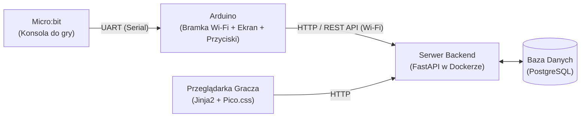
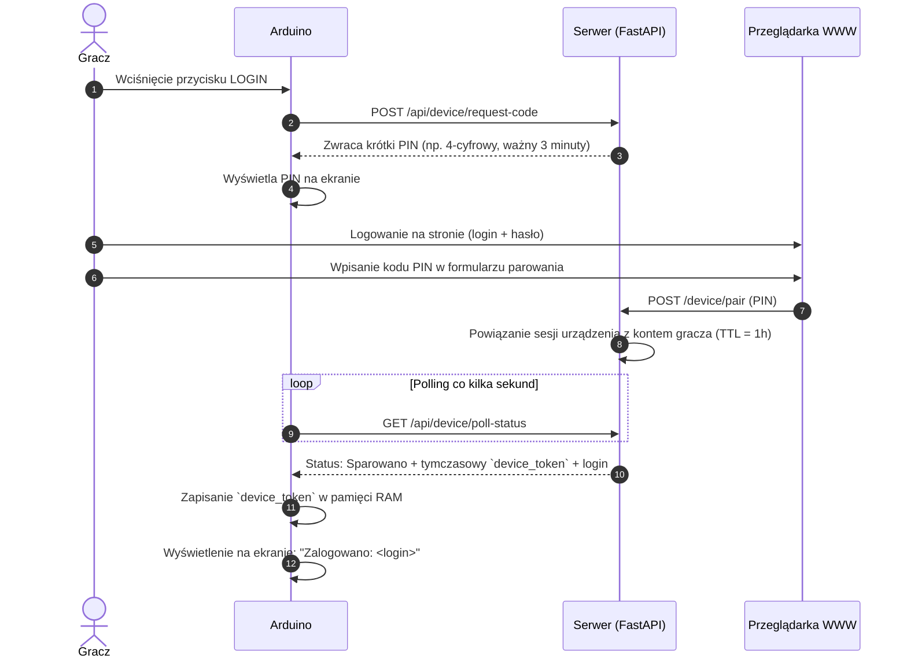

# System Gry Zręcznościowej IoT (Micro:bit + Arduino + Online Leaderboard)

> Niniejsza dokumentacja oraz treść opisu zostały zredagowane z pomocą modelu językowego (LLM). Cała koncepcja, podział ról oraz architektura techniczna systemu zostały wymyślone i zaprojektowane samodzielnie przez autora projektu.

---

## 1. Architektura systemu

System opiera się na separacji odpowiedzialności pomiędzy dwoma mikrokontrolerami a centralnym serwerem:

### Podział ról:

1. **Micro:bit (Konsola gry):**
   - Odpowiada wyłącznie za logikę rozgrywki zręcznościowej, detekcję wejść (przyciski, akcelerometr) oraz wyświetlanie stanu gry na matrycy LED 5x5.
   - Po zakończeniu rozgrywki przesyła uzyskany wynik punktowy do Arduino po przewodowej magistrali szeregowej (UART).
   - Nie posiada połączenia z siecią, co gwarantuje płynność pętli gry (brak opóźnień sieciowych).

2. **Arduino (Bramka IoT + Interfejs fizyczny):**
   - Połączone z Micro:bitem za pomocą interfejsu UART (piny TX/RX).
   - Odpowiada za łączność Wi-Fi z serwerem backendowym.
   - Posiada:
     - **Wyświetlacz (np. LCD/OLED):** prezentacja aktualnego rankingu TOP wyników, nazwy zalogowanego gracza lub wygenerowanego kodu PIN.
     - **Fizyczne przyciski funkcyjne:**
       - **Przycisk LOGIN:** żądanie wygenerowania nowego, krótkiego kodu PIN i wyświetlenie go na ekranie.
       - **Przycisk LOGOUT:** natychmiastowe usunięcie tokena sesji z pamięci RAM urządzenia i powrót do widoku rankingu.
   - Odbiera wynik z Micro:bita i przesyła go do API serwera.

3. **Backend & Baza Danych:**
   - **FastAPI (Python):** Obsługa logiki parowania urządzeń, zarządzanie czasem życia sesji (TTL = 1h), uwierzytelnianie użytkowników oraz endpointy REST API.
   - **PostgreSQL:** Przechowywanie danych o użytkownikach, aktywnych kodach PIN i historii wyników.
   - **Docker Compose:** Konteneryzacja całego środowiska umożliwiająca bezproblemowe wdrożenie na dowolnym VPS (brak vendor lock-in).

4. **Frontend WWW:**
   - Lekki interfejs renderowany po stronie serwera (**Jinja2**) ze stylami **Pico.css**.
   - Umożliwia rejestrację i logowanie (login + hasło), wprowadzenie kodu PIN wyświetlanego na Arduino oraz przeglądanie globalnego rankingu.

---

## 2. Przepływ autoryzacji i zarządzanie sesją

Logowanie opiera się na prostym modelu parowania (Device PIN Flow) za pomocą przycisków funkcyjnych na Arduino:

### Cykl życia sesji i wylogowanie:
- **Ważność kodu PIN:** Wygenerowany kod PIN jest aktywny przez **3 minuty**. Jeśli gracz nie wprowadzi go w tym czasie na stronie WWW, kod wygasa i należy wygenerować nowy przyciskiem `LOGIN`.
- **Czas trwania sesji:** Po poprawnym sparowaniu sesja gracza na urządzeniu jest ważna przez **1 godzinę**. Po tym czasie token po stronie serwera samoczynnie wygasa.
- **Wylogowanie (Przycisk LOGOUT):** 
  - Wciśnięcie przycisku `LOGOUT` na Arduino usuwa `device_token` z pamięci **RAM** urządzenia.
  - Ekran natychmiast wraca do trybu prezentacji rankingu TOP wyników.
  - Samodzielne wylogowanie czyści stan lokalny mikrokontrolera (sesja na serwerze wygasa naturalnie z upływem czasu).
- **Restart urządzenia:** Odcięcie zasilania lub reset Arduino powoduje utratę tokena z RAM bez wpływu na dane w bazie.

---

## 3. Komunikacja i protokoły

### A. Micro:bit $\leftrightarrow$ Arduino (UART)
Prosty protokół tekstowy zakończony znakiem nowej linii:
- Wysłanie wyniku: `SCORE:<wartość_liczbowa>\n` (np. `SCORE:150\n`).

### B. Arduino $\leftrightarrow$ Backend (HTTP REST API)
- `POST /api/device/request-code` – wygenerowanie i pobranie krótkiego PIN-u po wciśnięciu przycisku `LOGIN`.
- `GET /api/device/poll-status?device_id=...` – odpytywanie serwera o status zatwierdzenia PIN-u przez gracza.
- `POST /api/scores` – wysyłanie wyniku gry:
  - Nagłówek: `Authorization: Bearer <device_token>`
  - Body: `{"score": 150}`
- `GET /api/leaderboard?limit=5` – pobieranie najlepszych wyników do wyświetlenia na ekranie fizycznym.
