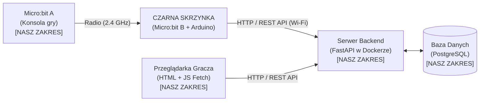

# System Gry Zręcznościowej IoT (Micro:bit + Arduino + Online Leaderboard)

> Dokumentacja i specyfikacja techniczna projektu z przedmiotu Języki i paradygmaty programowania (JIPP).

---

## 1. Architektura systemu

System opiera się na rozproszonym przepływie danych. Konsola gry (Micro:bit A) wysyła wyniki drogą radiową do sprzętowej bramki sieciowej (czarna skrzynka: Micro:bit B + Arduino), która przekazuje je przez Wi-Fi do centralnego serwera backendowego z bazą danych i publicznym rankingiem WWW.



---

## 2. Podział ról i zakres implementacji

Projekt dzieli się na komponenty realizowane w ramach naszego zadania oraz zewnętrzny zestaw sprzętowy ("czarna skrzynka"):

### A. Nasz zakres implementacji:
1. **Micro:bit A (Konsola gracza):**
   - Odpowiada za logikę rozgrywki zręcznościowej (MicroPython), obsługę wejść gracza (przyciski, akcelerometr) oraz prezentację stanu gry na matrycy LED 5x5.
   - Po zakończeniu rozgrywki wysyła drogą radiową (`radio`) pakiet do czarnej skrzynki zawierający:
     - identyfikator gracza (`player_id`, np. sprzętowy ID Micro:bita A),
     - uzyskany wynik (`score`),
     - pełny adres docelowy API serwera (`target_url`, np. `http://192.168.1.100:8000/api/scores`).
2. **Backend (FastAPI w kontenerze Docker):**
   - Endpoint REST API do zapisu wyników dostarczanych przez czarną skrzynkę (`POST /api/scores`).
   - Endpoint REST API do pobierania rankingu graczy (`GET /api/leaderboard`).
   - Serwowanie statycznych plików aplikacji webowej.
3. **Baza Danych (PostgreSQL):**
   - Pojedyncza tabela `scores` do trwałego przechowywania wpisów rankingowych.
4. **Frontend WWW (Aplikacja webowa):**
   - Prosty interfejs w czystym HTML + JavaScript (Fetch API).
   - Prezentuje publiczny ranking graczy z automatycznym oraz ręcznym odświeżaniem danych.

### B. Komponenty zewnętrzne / Czarna skrzynka:
1. **Czarna skrzynka (Micro:bit B + Arduino):**
   - Zestaw sprzętowy pośredniczący w transmisji danych:
     - **Micro:bit B:** odbiera pakiety radiowe od Micro:bita A i przekazuje dane po magistrali szeregowej (UART) do Arduino wraz z adresem `target_url` serwera.
     - **Arduino (bramka Wi-Fi):** odbiera ramkę z UART i wysyła zapytanie HTTP `POST` bezpośrednio pod wskazany `target_url`, dołączając znacznik czasu (`timestamp`).
   - Komunikacja opiera się na zdefiniowanym kontrakcie radiowym i HTTP REST API.

---

## 3. Baza Danych

Baza danych składa się z **jednej tabeli**:

### Tabela `scores`
| Kolumna | Typ | Opis |
| :--- | :--- | :--- |
| `id` | `INTEGER` / `SERIAL` | Klucz główny (Primary Key, autoincrement) |
| `player_id` | `VARCHAR(64)` | Identyfikator gracza (sprzętowy ID Micro:bita A) |
| `score` | `INTEGER` | Zdobyty wynik punktowy |
| `timestamp` | `TIMESTAMP` / `BIGINT` | Czas zarejestrowania wyniku przekazany przez czarną skrzynkę |

---

## 4. Komunikacja i kontrakt API

### Krok 1: Micro:bit A $\to$ Czarna skrzynka (Radio 2.4 GHz)
Komunikacja bezprzewodowa za pomocą modułu radiowego Micro:bit (MicroPython `radio`):
- Pakiety tekstowe zawierające pełny docelowy adres URL serwera (`target_url`), identyfikator urządzenia i wynik:
  ```json
  {
    "target_url": "http://192.168.1.100:8000/api/scores",
    "player_id": "mb-a8f1",
    "score": 150
  }
  ```

### Krok 2: Czarna skrzynka $\to$ Backend FastAPI (HTTP REST API)
Arduino wysyła wynik z gry pod wskazany `target_url`:
- **Metoda:** `POST`
- **URL:** `target_url` (np. `http://192.168.1.100:8000/api/scores`)
- **Format:** `application/json`
- **Body:**
  ```json
  {
    "player_id": "mb-a8f1",
    "score": 150,
    "timestamp": 1776363297
  }
  ```
- **Odpowiedź serwera (201 Created):**
  ```json
  {
    "status": "success",
    "id": 1
  }
  ```

### Krok 3: Przeglądarka WWW $\leftrightarrow$ Backend (REST API)
Aplikacja frontendowa asynchronicznie pobiera dane rankingu:
- **Metoda:** `GET /api/leaderboard?limit=10`
- **Odpowiedź:**
  ```json
  [
    {
      "rank": 1,
      "player_id": "mb-a8f1",
      "score": 150,
      "timestamp": 1776363297
    },
    {
      "rank": 2,
      "player_id": "mb-002c",
      "score": 120,
      "timestamp": 1776363100
    }
  ]
  ```

---

## 5. Frontend WWW

Aplikacja kliencka składa się ze strony WWW serwowanej przez backend:
- **`index.html`** – prosty interfejs w HTML.
- **`app.js`** – skrypt realizujący pobieranie danych za pomocą `fetch('/api/leaderboard')` i renderujący dynamiczną tabelę rankingu.
