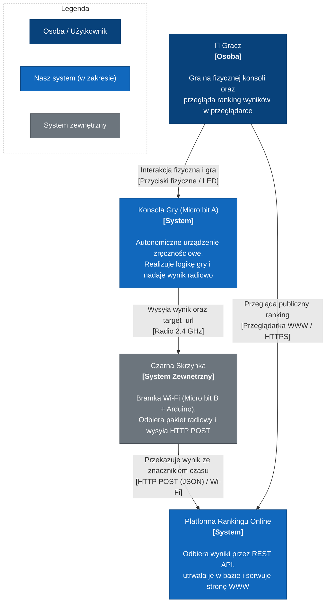
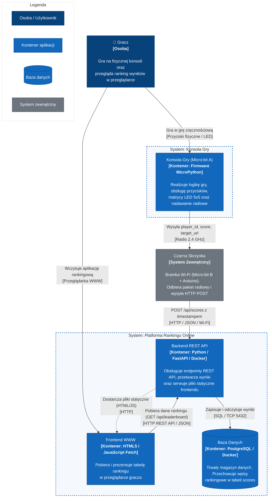

# Architektura Systemu w Modelu C4 (Poziomy 1 i 2)

Dokumentacja architektoniczna projektu **System Gry Zręcznościowej IoT (Micro:bit + Arduino + Online Leaderboard)** opracowana zgodnie ze standardem C4 model (Simon Brown).

Plik zawiera skonsolidowane i poprawione diagramy architektury dla **Poziomu 1 (Kontekst Systemu)** oraz **Poziomu 2 (Kontenery)** wraz z kompletnymi opisami technicznymi i legendą.

---

## Poziom 1: Kontekst Systemu (System Context)

Diagram kontekstu przedstawia systemy wchodzące w skład rozwiązania na najwyższym poziomie abstrakcji, ich granice, użytkowników (aktorów) oraz relacje z zewnętrznym środowiskiem transmisyjnym.

W ramach rozwiązania funkcjonują dwa systemy wchodzące w zakres implementacyjny projektu:
1. **Konsola Gry (Micro:bit A)** – autonomiczny system wbudowany (*embedded*).
2. **Platforma Rankingu Online** – system serwerowo-webowy.

Pomiędzy nimi pośredniczy zewnętrzny węzeł transmisyjny – **Czarna Skrzynka** (bramka Wi-Fi oparta na Micro:bit B i Arduino).

### Diagram kontekstu

### Opis elementów poziomu 1

| Element | Typ | Opis |
| :--- | :--- | :--- |
| **Gracz** | Osoba | Użytkownik fizycznie grający na konsoli Micro:bit A oraz weryfikujący swoje pozycje w rankingu przez przeglądarkę WWW. |
| **Konsola Gry (Micro:bit A)** | System (nasz zakres) | System wbudowany realizujący pętlę gry, detekcję wejść i wyświetlanie stanu gry. Po zakończeniu rozgrywki rozgłasza wynik radiowo. |
| **Czarna Skrzynka** | System zewnętrzny | Sprzętowa bramka Wi-Fi (Micro:bit B + Arduino). Odbiera pakiet radiowy od konsoli i wykonuje żądanie sieciowe `POST` pod wskazany adres `target_url`. |
| **Platforma Rankingu Online** | System (nasz zakres) | Centralny system odbierający wyniki przez REST API, utrwalający je w relacyjnej bazie danych oraz serwujący stronę rankingu. |

---

## Poziom 2: Kontenery (Containers)

Diagram kontenerów przedstawia dekompozycję systemów na niezależnie wdrażalne i uruchamialne jednostki oprogramowania (firmware, aplikacja kliencka, usługa backendowa, baza danych) oraz protokoły komunikacyjne pomiędzy nimi.

W architekturze zdefiniowano:
- **System: Konsola Gry** – kontener z oprogramowaniem wbudowanym (firmware MicroPython).
- **System: Platforma Rankingu Online** – trzy kontenery:
  1. **Frontend WWW** – statyczna aplikacja internetowa (HTML5 / JS Fetch API) wykonywana w przeglądarce gracza.
  2. **Backend REST API** – aplikacja serwerowa (FastAPI) w kontenerze Docker.
  3. **Baza Danych** – instancja PostgreSQL w kontenerze Docker.
- **Czarna Skrzynka** – zewnętrzny węzeł transmisyjny.

### Diagram kontenerów

### Opis elementów poziomu 2

| Kontener / Element | Technologia | Rola i odpowiedzialność | Komunikacja |
| :--- | :--- | :--- | :--- |
| **Konsola Gry (Micro:bit A)** | Firmware MicroPython | Realizacja logiki gry zręcznościowej, odczyt przycisków, obsługa animacji LED. Po zakończeniu nadaje radiowo identyfikator gracza, wynik oraz `target_url`. | `Radio 2.4 GHz` do Czarnej Skrzynki. |
| **Czarna Skrzynka** | Micro:bit B + Arduino (C++) | Pośrednik transmisyjny: Micro:bit B odbiera radio i przesyła UART-em do Arduino, które wysyła żądanie HTTP z dołączonym znacznikiem czasu. | Odbiór `Radio 2.4 GHz`, wysyłka `HTTP POST (Wi-Fi)` do API. |
| **Frontend WWW** | HTML5, JavaScript (Fetch API) | Lekki interfejs renderowany w przeglądarce internetowej gracza, prezentujący tabelę najlepszych wyników. | `HTTP GET /api/leaderboard` do Backend API. |
| **Backend REST API** | Python 3, FastAPI, Docker | Obsługa zapytań HTTP: `POST /api/scores` (walidacja i zapis wyniku) oraz `GET /api/leaderboard` (pobranie wyników). Serwuje pliki statyczne strony WWW. | Odbiór `HTTP` (port 8000), komunikacja z bazą przez `TCP 5432`. |
| **Baza Danych** | PostgreSQL, Docker | Przechowywanie tabeli `scores` (`id`, `player_id`, `score`, `timestamp`). Zapewnia trwałość i spójność danych rankingu. | Protokół PostgreSQL (`TCP 5432`). |

---

## Kluczowe usprawnienia wprowadzone względem wersji roboczej

1. **Jawne granice systemowe (System Boundaries):** Na Poziomie 2 wydzielono `SYS_CONSOLE`, co eliminuje problem kontenera zawieszonego poza jakimkolwiek systemem.
2. **Kierunkowość relacji (Unidirectional Arrows):** Zlikwidowano dwukierunkową strzałkę `SPA <--> API`. Relacje precyzyjnie rozróżniają pobieranie danych rankingu (odpytywanie API przez SPA) od dostarczania plików aplikacji webowej.
3. **Legenda diagramów:** Każdy diagram posiada zintegrowany klucz wizualny wyjaśniający role elementów i styl obramowania.
4. **Przenośność ikon:** Zastąpiono selektory FontAwesome uniwersalnymi symbolami Unicode, dzięki czemu diagramy renderują się bezbłędnie w każdym silniku Markdown.
