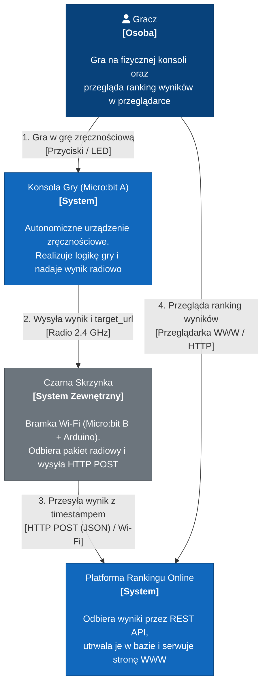

# Architektura Systemu w Modelu C4

Dokumentacja architektoniczna projektu **System Gry Zręcznościowej IoT (Micro:bit + Arduino + Online Leaderboard)** opracowana zgodnie ze standardem C4 model.

---

## Poziom 1: Kontekst Systemu (System Context)

Diagram kontekstu przedstawia systemy wchodzące w skład rozwiązania na najwyższym poziomie abstrakcji, ich granice, użytkowników (aktorów) oraz relacje z zewnętrznym środowiskiem transmisyjnym.

W ramach rozwiązania zdefiniowano dwa niezależne systemy:
1. **Konsolę Gry (Micro:bit A)** – autonomiczny system wbudowany (embedded).
2. **Platformę Rankingu Online** – system serwerowo-webowy.

Pomiędzy nimi pośredniczy zewnętrzna **Czarna Skrzynka** (bramka Wi-Fi).

### Diagram kontekstu

### Opis elementów kontekstu

#### 1. Aktorzy (People)
* **Gracz (Player):**
  - Wchodzi w bezpośrednią, fizyczną interakcję z konsolą Micro:bit A (sterowanie przyciskami, obserwacja gry na matrycy LED).
  - Korzysta z przeglądarki internetowej, aby sprawdzać aktualne wyniki w rankingu.

#### 2. Systemy wchodzące w zakres projektu (Our Systems)
* **Konsola Gry (Micro:bit A):**
  - Niezależny system wbudowany (firmware MicroPython).
  - Odpowiada za pętlę gry, zliczanie punktów, a po zakończeniu rozgrywki za nadanie bezprzewodowego komunikatu radiowego zawierającego `player_id`, `score` oraz `target_url`.
* **Platforma Rankingu Online:**
  - System serwerowy (FastAPI + PostgreSQL + statyczny interfejs WWW).
  - Wystawia punkt końcowy REST API do odbioru wyników, zapisuje je trwale w relacyjnej bazie danych oraz serwuje stronę WWW z tabelą wyników.

#### 3. Systemy zewnętrzne (External Systems)
* **Czarna Skrzynka (Bramka Wi-Fi: Micro:bit B + Arduino):**
  - Zewnętrzny węzeł transmisyjny pośredniczący w komunikacji.
  - Odbiera pakiet radiowy od konsoli i wykonuje żądanie sieciowe `POST` pod wskazany w pakiecie adres `target_url`, uzupełniając dane o znacznik czasu (`timestamp`).
