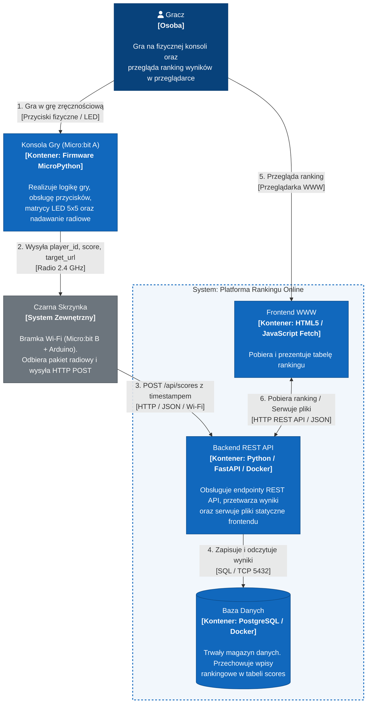

# Architektura Systemu w Modelu C4

Dokumentacja architektoniczna projektu **System Gry Zręcznościowej IoT (Micro:bit + Arduino + Online Leaderboard)** opracowana zgodnie ze standardem C4 model.

---

## Poziom 2: Kontenery (Containers)

Diagram kontenerów przedstawia architekturę techniczną wysokiego poziomu – dekompozycję systemów na niezależnie wdrażalne jednostki wykonawcze (aplikacje, bazy danych, firmware) oraz protokoły komunikacji między nimi.

W naszym rozwiązaniu zdefiniowano następujące kontenery:
1. **Konsola gracza (Micro:bit A)**
2. **Frontend WWW** – strona internetowa z wynikami w przeglądarce.
3. **Backend REST API** – w kontenerze Docker.
4. **Baza Danych** – PostgreSQL w kontenerze Docker.

Pomiędzy konsolą a backendem pośredniczy **Czarna Skrzynka** (Micro:bit B + Arduino).

### Diagram kontenerów

### Opis kontenerów

#### 1. Kontenery Systemu Konsoli Gry
* **Gra (Micro:bit A):**
  - **Odpowiedzialność:** Pętla gry zręcznościowej, detekcja wejść z przycisków i sensorów, wyświetlanie animacji i punktów na matrycy LED 5x5.
  - **Komunikacja:** Po zakończeniu rozgrywki nadaje bezprzewodowo pakiet radiowy (2.4 GHz) zawierający identyfikator gracza, wynik oraz `target_url`.

#### 2. Kontenery Systemu Platformy Rankingu Online
* **Frontend WWW (Fetch API):**
  - **Odpowiedzialność:** Lekki interfejs użytkownika uruchamiany w przeglądarce internetowej gracza.
  - **Komunikacja:** Wysyła żądania `GET /api/leaderboard` do Backend API i wstawia dane do tabeli rankingu.
* **Backend REST API [Python, FastAPI, Docker]:**
  - **Odpowiedzialność:**
    - Udostępnienie endpointa `POST /api/scores` do zapisu nowego wyniku nadesłanego przez bramkę sieciową.
    - Udostępnienie endpointa `GET /api/leaderboard` zwracającego posortowany ranking wyników.
    - Serwowanie statycznych plików strony WWW (`index.html`, `app.js`).
  - **Komunikacja:** Odbiera ruch HTTP od Czarnej Skrzynki i Frontendu; komunikuje się z bazą danych przez protokół PostgreSQL (TCP port 5432).
* **Baza Danych [PostgreSQL, Docker]:**
  - **Odpowiedzialność:** Trwałe przechowywanie historii wyników w pojedynczej tabeli `scores` (`id`, `player_id`, `score`, `timestamp`).
  - **Komunikacja:** Połączenie TCP na domyślnym porcie 5432 z kontenerem Backend API.

#### 3. Zewnętrzne
* **Czarna Skrzynka [Micro:bit B + Arduino]:**
  - Zewnętrzny moduł transmisyjny: odbiera radiowy komunikat z Micro:bita A, formatuje go do JSON i przesyła jako żądanie HTTP `POST` pod wskazany `target_url` serwera.
